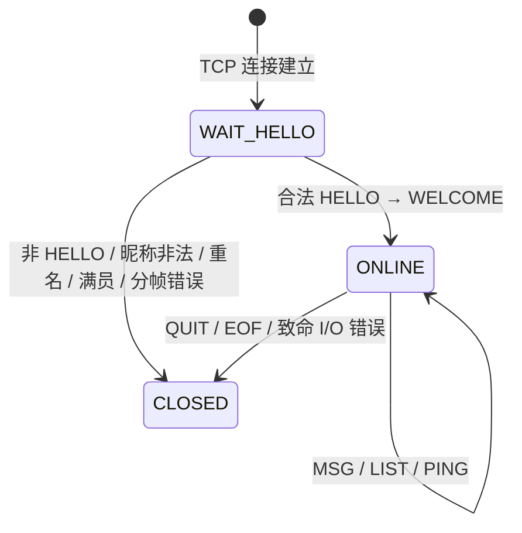
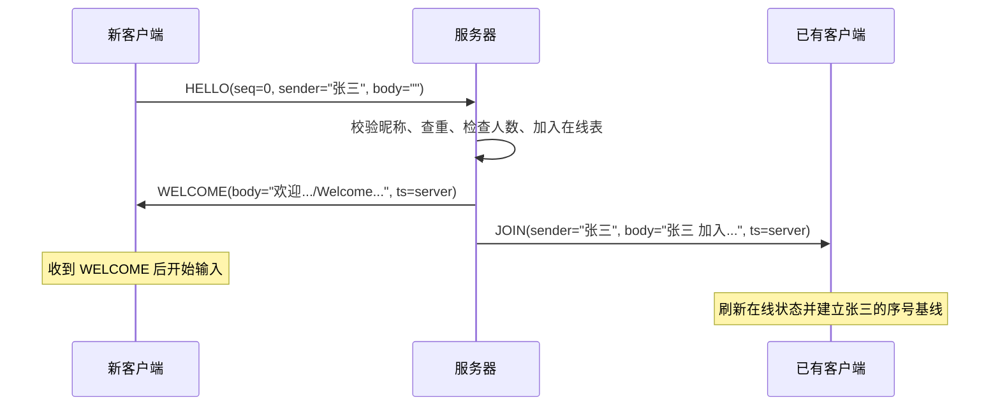
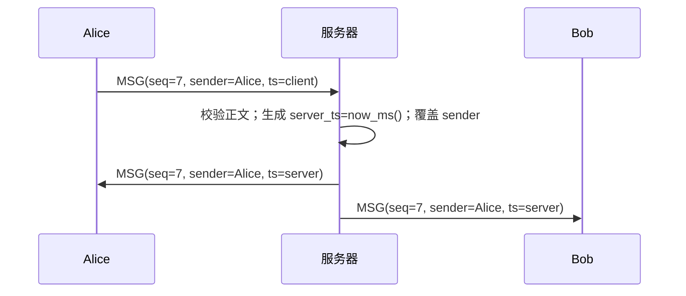
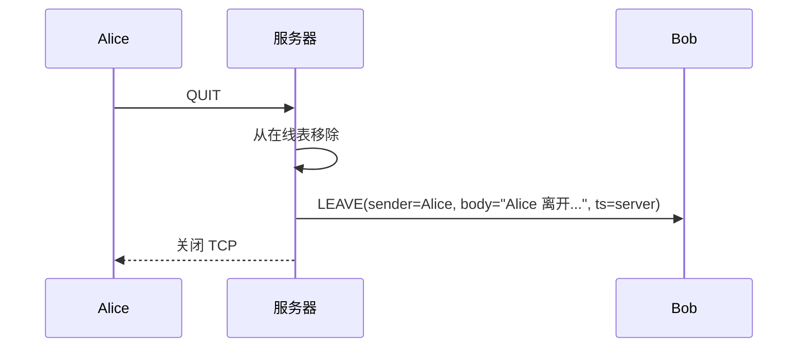
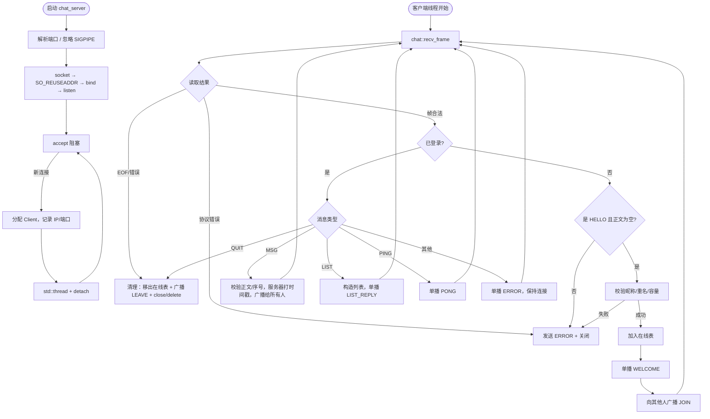
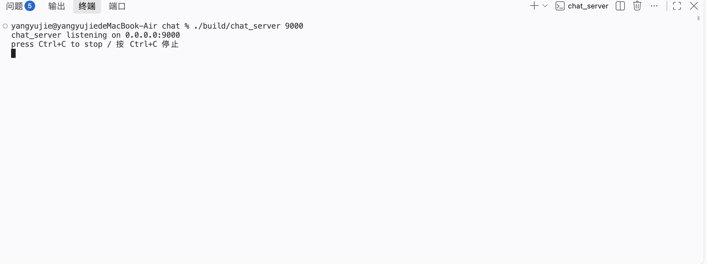
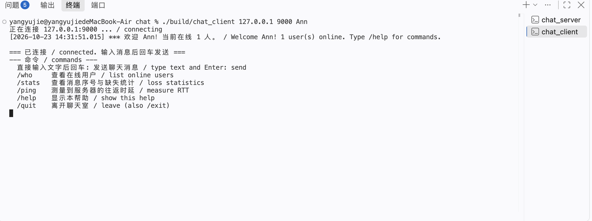
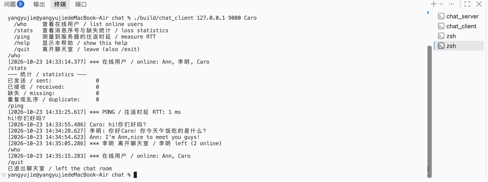

# 基于流式 Socket 的多线程中英文聊天室实验报告（C++17）

## 摘要

本实验使用 C++17 和 POSIX 基本 Socket 函数实现了一个基于 TCP 的多人在线聊天室。
系统采用客户端/服务器（C/S）结构：服务器为每个连接创建一个线程，维护在线用户表，
并向所有在线用户广播聊天消息；客户端使用输入线程和接收线程分离键盘输入与网络接收。

在 TCP 字节流之上设计并实现了自定义应用层协议 **CHAT/1**。协议采用“文本头 +
字节长度 + UTF-8 消息体”的帧格式，能够正确处理 TCP 粘包/半包；聊天消息由服务器
统一加盖毫秒级时间戳并分配/回显消息序号，因此支持时间显示、消息丢失检查和多人聊天。
程序完整支持中文与英文，不进行字符集转换。当前实现为 C++17。

本次实验完成了以下验证：

- 4 个并发客户端，每个发送 200 条中英文消息，共产生 3200 次消息投递；
- 每个客户端均收到全部 800 条广播消息，缺失 0 条、重复 0 条、序号缺口 0；
- 所有消息均带有效的服务器时间戳，中文 UTF-8 往返正确；
- AddressSanitizer、UndefinedBehaviorSanitizer、ThreadSanitizer 检查均无错误报告。

---

## 1. 实验目标与总体方案

### 1.1 需求对应关系

| 实验要求 | 实现方式 |
|---|---|
| 流式 Socket、自定义聊天协议、消息带时间 | TCP + CHAT/1 帧协议，服务器毫秒时间戳 |
| 模块划分、模块功能、流程图 | 见第 3 章 |
| C/C++、基本 Socket 函数、无封装类 | C++17 + `socket/bind/listen/accept/connect/send/recv` + `std::thread`/`std::mutex` |
| 英文和中文聊天 | 全程 UTF-8，按字节计长度，不做转码 |
| 多线程、多人聊天 | 服务器每连接一线程；客户端输入/接收双线程 |
| 结构清晰、可读性 | 协议层与业务层分离，见 3.1、3.7 |
| 观察数据包丢失 | 消息序号 + `/stats` + 服务器缺口日志 + 自动化测试，见第 5 章 |

### 1.2 总体结构

```text
┌──────────────────────┐        TCP / CHAT/1         ┌──────────────────────┐
│      chat_client     │◄───────────────────────────►│      chat_server     │
│                      │                             │                      │
│  main/input thread   │                             │  main accept thread  │
│  receiver thread     │                             │  thread per client   │
│  protocol.h/.cpp   │                             │  online table+mutex  │
└──────────────────────┘                             │  protocol.h/.cpp   │
                                                     └──────────────────────┘
```

- **客户端**：连接服务器，发送 `HELLO` 登录；主线程读取标准输入并发送消息，
  接收线程不断读取服务器帧并显示。两者通过输出互斥锁、原子运行标志和握手条件变量协作。
- **服务器**：主线程只负责 `accept`；每个已接受连接由独立线程处理登录、消息、
  在线列表、PING 和退出。服务器是唯一的时间戳与发送者身份权威，避免客户端伪造。
- **传输层**：TCP（`SOCK_STREAM`）是可靠、有序的字节流，但本身没有消息边界，
  因此自定义协议必须自己解决分帧问题。

### 1.3 程序文件

```text
.
├── Makefile
├── README.md
├── src/
│   ├── protocol.h      # 协议常量、数据结构、公共接口
│   ├── protocol.cpp      # 帧编码/解码、严格字段校验、时间格式化
│   ├── server.cpp        # 监听、连接线程、在线表、广播、服务器日志
│   └── client.cpp        # 连接、握手、接收线程、输入循环、统计
├── tools/
│   └── load_test.py    # 应用层完整性/丢包观测测试工具（非聊天程序本体）
└── docs/
    └── report.md       # 本报告
```

---

## 2. CHAT/1 聊天协议设计

本章对应实验要求（1）。

### 2.1 传输方式与设计选择

协议运行在 TCP 字节流上，默认端口 9000。TCP 只保证字节可靠有序到达，不保留
`send()` 的边界：一次 `recv()` 可能读到半条消息，也可能读到两条半消息。因此
CHAT/1 采用**显式长度分帧**：

```text
+--------------------------------------------------+---------------------------+
| ASCII 头（以 CRLF 结尾，各字段用 TAB 分隔）      | 消息体（恰好 BODY_LEN 字节）|
+--------------------------------------------------+---------------------------+
```

选择这种格式的原因：

1. **长度按字节计**，不按字符计。汉字在 UTF-8 中通常占 3 字节，按字符计会截断。
2. 消息体可以包含空格、制表符、换行符甚至任意字节，不必转义；接收方只认长度。
3. 头部字段固定为 6 个 ASCII 字段，解析简单，错误可检测。
4. 接收方先读完整头部，再循环读取恰好 `BODY_LEN` 字节，从机制上消除粘包/半包。

### 2.2 帧格式与字段语义

头部一行的精确格式为（`\t` 表示一个制表符，`\r\n` 表示回车换行）：

```text
CHAT/1\tTYPE\tSEQ\tSENDER\tTIMESTAMP_MS\tBODY_LEN\r\n
BODY
```

字段定义：

| 字段 | 编码/范围 | 语义 |
|---|---|---|
| `CHAT/1` | 固定 6 字节 ASCII | 协议名与版本，必须完全匹配 |
| `TYPE` | 大写 ASCII 单词 | 消息类型，见表 2-1 |
| `SEQ` | 十进制 `uint64` | 聊天消息序号；`MSG` 必须为正，控制帧为 0 或回显请求序号 |
| `SENDER` | UTF-8，1～32 字节 | 发送者昵称；不得含 TAB/CR/LF/控制字符 |
| `TIMESTAMP_MS` | 十进制 64 位整数 | Unix 纪元起的毫秒数；服务器下发的值即聊天时间 |
| `BODY_LEN` | 十进制，0～65536 | 消息体的**字节数**，不是字符数 |

其他限制：

- 头部总长不超过 512 字节；
- 单条聊天正文应用层上限 8192 字节（`CHAT_MAX_MESSAGE`）；
- 昵称不超过 32 个 UTF-8 字节；
- 头部字段区分大小写；字段之间**恰好**用 `\t` 分隔。

示例 1：客户端登录（`SENDER` 为期望昵称，正文为空，`SEQ=0`）：

```text
CHAT/1\tHELLO\t0\tAlice\t1729650000123\t0\r\n
```

示例 2：客户端发送聊天消息：

```text
CHAT/1\tMSG\t7\tAlice\t1729650000456\t15\r\n
你好，Hello!
```

`你好，Hello!` 共 9 个字符，其中汉字和中文逗号各占 3 字节，UTF-8 共 15 字节，
因此 `BODY_LEN=15`。这直接说明了为什么长度必须按字节计算。

示例 3：服务器广播给所有客户端（时间戳和发送者由服务器填写）：

```text
CHAT/1\tMSG\t7\tAlice\t1729650000471\t15\r\n
你好，Hello!
```

### 2.3 形式化语法

采用 ABNF 风格描述：

```abnf
frame       = header CRLF body
header      = protocol HTAB type HTAB seq HTAB sender HTAB timestamp HTAB body-len

protocol    = %s"CHAT/1"
type        = %s"HELLO" / %s"WELCOME" / %s"MSG" / %s"JOIN" / %s"LEAVE"
            / %s"SYS" / %s"LIST" / %s"LIST_REPLY" / %s"PING"
            / %s"PONG" / %s"QUIT" / %s"ERROR"
seq         = 1*20DIGIT          ; 0 .. 2^64-1
sender      = 1*32( UTF8-octet ) ; 不允许 HTAB / CR / LF / 控制字符
timestamp   = 1*20DIGIT          ; Unix 毫秒
body-len    = 1*5DIGIT           ; 0 .. 65536
body        = *OCTET             ; 聊天正文按 UTF-8 解释
HTAB        = %x09
CRLF        = %x0D %x0A
DIGIT       = %x30-39
```

解析状态机（接收任意一帧）：

```text
1. 从 socket 逐字节读取，直到 '\n'，最多 511 字节；超限 → 协议错误。
2. 去掉末尾 '\r'；按 '\t' 切分，必须恰好得到 6 个非空字段。
3. 校验协议名、类型、三个十进制字段；任一非法 → 协议错误。
4. 检查 BODY_LEN ≤ 65536；否则不读取正文，直接关闭连接。
5. 循环 recv，直到恰好读满 BODY_LEN 字节（处理半包和多次到达）。
6. 正文后无额外分隔符；下一字节即下一帧的 'C'。
```

这种“头部行 + 精确字节数”的读法使一次 `recv()` 的返回边界与消息边界无关。
`send_all` 也会循环发送，处理 TCP 发送缓冲区不足导致的短写。

### 2.4 消息类型、语法和语义

#### 2.4.1 客户端到服务器

| 类型 | `SEQ` | `SENDER` | `BODY` | 语义与约束 |
|---|---:|---|---|---|
| `HELLO` | 0 | 期望昵称 | 空 | 连接后的第一条消息；登录。只接受一次 |
| `MSG` | ≥1，逐条递增 | 客户端昵称 | UTF-8 正文 | 聊天；服务器忽略头部昵称，改用登录昵称 |
| `LIST` | 0 | 昵称 | 空 | 请求在线用户列表 |
| `PING` | 0 | 昵称 | 空 | 连通性/时延探测 |
| `QUIT` | 0 | 昵称 | 空 | 正常离开；服务器广播 `LEAVE` 后关闭 |

客户端发送的 `TIMESTAMP_MS` 只作客户端本地时间参考，服务器不会用它作为广播时间，
以避免不同客户端时钟不一致。

#### 2.4.2 服务器到客户端

| 类型 | 目标 | `SEQ` | `SENDER` | `BODY` | 语义 |
|---|---|---|---:|---|---|
| `WELCOME` | 登录者 | 0 | `server` | 欢迎语、在线人数 | 登录成功；客户端据此完成握手 |
| `MSG` | 所有人 | 原消息序号 | 发送者昵称 | 原文 | 聊天广播，包含发送者自己（回显） |
| `JOIN` | 其他在线者 | 0 | 加入者昵称 | 加入提示 | 新用户加入，用于显示与序号基线重置 |
| `LEAVE` | 其他在线者 | 0 | 离开者昵称 | 离开提示 | 用户正常退出或断线 |
| `SYS` | 指定/所有人 | 0 | `server` | 系统文本 | 预留的系统通知类型 |
| `LIST_REPLY` | 请求者 | 请求的 `SEQ` | `server` | 逗号分隔昵称 | `/who` 的回复（供人阅读） |
| `PONG` | 请求者 | 请求的 `SEQ` | `server` | 空 | 对 `PING` 的响应 |
| `ERROR` | 出错者 | 0 | `server` | 中英文错误说明 | 非致命错误后可继续；登录/分帧错误后关闭 |

`JOIN` 和 `LEAVE` 使用离开/加入者的昵称作为 `SENDER`，客户端据此清理或重建该发送者的
序号跟踪状态。`MSG` 的 `SENDER` 一定是服务器登记的昵称，不能由客户端在正文中伪造。

### 2.5 状态机与时序

#### 2.5.1 连接状态



服务器在 `WAIT_HELLO` 状态只接受 `HELLO`。若第一条帧不是 `HELLO`，服务器回复
`ERROR` 并关闭连接。进入 `ONLINE` 后才能发送 `MSG`、`LIST`、`PING`、`QUIT`。

#### 2.5.2 登录时序



关键时序保证：

1. 服务器在**同一把在线表互斥锁**内完成“加入列表 → 发送 WELCOME → 向其他人广播
   JOIN”。因此，之后任何客户端发来的 `MSG` 广播都发生在 JOIN 之后。
2. 客户端收到 `WELCOME` 才认为登录成功；客户端最多等待 10 秒，超时则断开。
3. 登录者的 WELCOME 先于（对其他人可见的）JOIN 广播；登录者自己不接收自己的 JOIN。

#### 2.5.3 聊天消息时序



- 广播对象包括发送者，因此客户端不需要本地“假回显”；自己看到的消息也带有服务器时间。
- 对同一条消息，所有接收者收到相同的 `SEQ`、`SENDER` 和 `TIMESTAMP_MS`。
- 服务器持锁按在线表顺序逐个发送，所有接收者观察到一致的广播顺序。
- 服务器收到消息时就打时间戳，而不是按客户端时间或发送顺序猜测。

#### 2.5.4 离开时序



若客户端直接断网或进程退出，服务器线程的 `recv()` 返回 0 或错误，同样执行移除和
`LEAVE` 广播。`QUIT` 与异常断开在广播行为上等价。

### 2.6 错误处理与连接生命周期

| 情况 | 服务器处理 | 是否关闭 |
|---|---|---|
| 协议名/类型/数字字段非法 | 尽力发送 `ERROR`，记录日志 | 是 |
| 头部超长、字段数不是 6、正文超 65536 | 发送 `ERROR`（若还能写） | 是 |
| 登录前发送非 `HELLO` | `ERROR: send HELLO first` | 是 |
| 昵称为空/过长/含控制字符/重名/满员 | `ERROR` | 是 |
| 空 `MSG`、正文超过 8192 字节、正文含 NUL | `ERROR` | 否，继续服务 |
| 客户端发送服务器专用类型 | `ERROR: client may not send ...` | 否 |
| 对端关闭（EOF） | 移除、广播 `LEAVE`、释放资源 | 是 |
| 向某客户端发送失败 | `shutdown` 该连接，由该线程清理并广播 `LEAVE`，不无限阻塞 | 是（该客户端） |

对于 `ERROR` 后是否关闭连接，协议给出明确规则：**分帧/登录阶段的错误关闭连接；
已登录后的业务错误保留连接**。客户端根据 `ERROR` 文本显示提示。

服务器对每个已连接 socket 设置 5 秒发送超时（`SO_SNDTIMEO`），避免一个不读取数据的
慢客户端永久阻塞广播线程。

### 2.7 中英文支持

- 客户端从终端读取的字节按 UTF-8 原样放入 `BODY`，服务器不解析、不转码、不改写，
  直接按原始字节广播。
- `BODY_LEN`、`CHAT_MAX_MESSAGE`、昵称长度全部按 **UTF-8 字节**计算，避免把汉字截断。
- 中文昵称如“张三”占 6 字节；32 字节昵称上限可容纳约 10 个汉字。
- 系统消息（欢迎、加入、离开、错误）采用中英双语；用户聊天内容完全自由。
- 只要终端、SSH 客户端和字体使用 UTF-8，中文即可正确显示。

---

## 3. 聊天程序设计

本章对应实验要求（2）和（6）。

### 3.1 模块划分

```text
┌──────────────────────── chat_client 进程 ────────────────────────┐
│                                                                  │
│  main / 输入线程                 receiver 线程                    │
│  ┌────────────────────┐          ┌────────────────────┐          │
│  │ 参数解析、connect   │          │ recv_frame 循环     │          │
│  │ HELLO/等待 WELCOME  │          │ 显示、序号统计      │          │
│  │ select(stdin)+命令  │          │ PONG/RTT、ERROR     │          │
│  └─────────┬──────────┘          └─────────┬──────────┘          │
│            └──────────────┬────────────────┘                     │
│                    protocol.h/.cpp（组帧/拆帧）                      │
└───────────────────────────────┬──────────────────────────────────┘
                                │ TCP / CHAT/1
┌───────────────────────────────┴──────────────────────────────────┐
│                         chat_server 进程                          │
│  main / accept 线程            每个连接一个 client 线程            │
│  ┌────────────────────┐        ┌──────────────────────────┐       │
│  │ socket/bind/listen │        │ HELLO 校验、登录          │       │
│  │ accept + std::thread   │        │ MSG/LIST/PING/QUIT       │       │
│  │ 分配 Client        │        │ 在线表 + 广播 + 清理     │       │
│  └─────────┬──────────┘        └────────────┬─────────────┘       │
│            └──────────────┬─────────────────┘                     │
│                    protocol.h/.cpp（组帧/拆帧）                      │
└──────────────────────────────────────────────────────────────────┘
```

模块职责：

| 模块 | 主要函数 | 功能 |
|---|---|---|
| `protocol.h/.cpp` | `chat::send_frame`、`chat::recv_frame`、`chat::now_ms`、`chat::format_time`、`chat::validate_nick` | 协议唯一实现层：组帧、拆帧、严格字段校验、UTF-8 字节长度、时间格式化、昵称校验 |
| `server.cpp` | `main`、`create_listener`、`client_thread`、`register_client`、`handle_client_frame`、`handle_message`、`handle_list`、`unregister_client`、`broadcast_locked` | 监听与接入、登录、在线用户表、消息路由与广播、在线列表、PING、异常清理、服务器日志 |
| `client.cpp` | `main`、`connect_to_server`、`receiver_thread`、`handle_server_frame`、`input_loop`、`handle_command`、`update_sequence_stats` | 连接与握手、异步接收、终端输入与命令、时间显示、RTT、序号缺口统计 |
| `tools/load_test.py` | — | 仅测试：多客户端并发、逐条校验消息完整性 |
| `Makefile` | — | 按 C++17 编译，开启全部常用警告 |

模块边界清晰：**`protocol.cpp` 不知道业务，`server.cpp`/`client.cpp` 不手工拼接协议文本**。
这样修改协议只需改协议层，业务层调用相同接口。

### 3.2 关键数据结构

协议帧（`protocol.h`）：

```cpp
namespace chat {

enum class Type {
    Hello, Welcome, Msg, Join, Leave, Sys,
    List, ListReply, Ping, Pong, Quit, Error
};

struct Frame {
    Type type = Type::Error;
    std::uint64_t seq = 0;
    std::string sender;
    std::uint64_t timestamp_ms = 0;
    std::string body;      // std::string 自动管理正文内存
};

} // namespace chat
```

服务器在线节点与在线表：

```cpp
struct Client {
    int fd = -1;
    std::string nick;
    std::string peer_ip;
    unsigned int peer_port = 0;
    std::uint64_t last_client_seq = 0; // 服务器侧缺口诊断
};

std::vector<Client *> g_clients;
std::mutex g_clients_mutex;
```

客户端统计与序号跟踪：

```cpp
struct ChatStats {
    std::uint64_t sent = 0;
    std::uint64_t received = 0;
    std::uint64_t missing = 0;
    std::uint64_t duplicates = 0;
};

// 发送者昵称 -> 最近一次已收到的序号
std::unordered_map<std::string, std::uint64_t> g_last_seq;
```

`g_last_seq` 按发送者记录序号：

- 客户端登录时已经在线的发送者：第一次看到其消息时以当前序号为基线，避免把登录前
  的历史消息误判为丢失；
- 收到某发送者的 `JOIN`：将其基线重置为 0，该连接的首条消息应为 1；
- 收到 `LEAVE`：删除该发送者的记录；
- 之后若 `seq > last + 1` 计为缺失，若 `seq <= last` 计为重复/乱序。

C++ 的 `std::string`、`std::vector`、`std::unordered_map` 负责内存生命周期，协议层
不再暴露需要手工 `free` 的裸指针。

### 3.3 并发与线程安全

#### 服务器

- 主线程：`socket → bind → listen → accept` 循环；每个连接用 `new (std::nothrow)` 分配 `Client`，
  用 `std::thread(client_thread, client).detach()` 启动分离线程。
- 每客户端线程：阻塞在 `chat::recv_frame` 上，处理该连接的全部协议消息。
- 全局 `g_clients_mutex` 同时保护**在线表**和**所有向客户端 socket 的写入**。
  这样做有两个直接好处：
  1. 同一客户端不会收到两个线程交错写入的“半帧 + 半帧”；
  2. 广播时持有锁遍历在线表，客户端不会在发送过程中被其他线程释放。
- 锁内不做 `recv`、文件 I/O 或长时间计算；只做内存操作和有限时 `send`。
- 服务器发送超时为 5 秒。若某个客户端持续不读，广播最多被拖慢 5 秒后被 `shutdown`，
  不会永久卡死。
- 最大在线人数 `kMaxClients=64`，超限发送 `ERROR` 并拒绝。

#### 客户端

- 主线程负责 `connect`、`HELLO`、等待 `WELCOME`、读取终端输入和发送。
- 接收线程独立阻塞在 `chat::recv_frame`，因此即使服务器异步广播，输入也不会被阻塞。
- `g_output_mutex` 串行化两条线程的终端输出，避免一行消息被另一行撕裂。
- `g_running`、`g_handshake_state` 使用 `std::atomic`；握手完成/失败通过 `std::condition_variable` 通知。
- 主线程使用 `select(STDIN_FILENO)` 并设置 200ms 超时，从而在连接被服务器关闭时
  能及时退出，而不是永远阻塞在阻塞式输入读取。
- 客户端只有主线程发送数据（接收线程只读），因此同一方向不会出现并发写帧。

#### 锁顺序

服务器不存在“持有日志锁再去拿在线表锁”的路径：`log_msg` 获取并释放日志锁后才返回；
在线表路径可能在持锁时调用日志。客户端统计锁、输出锁、状态锁各自只覆盖短临界区，
没有嵌套交叉获取，因此不会形成环。

### 3.4 服务器流程图



对应文字流程：

1. 服务器启动并监听端口。
2. 主线程循环 `accept`，每个连接创建一个分离线程。
3. 新线程等待第一条帧，只接受合法的 `HELLO`。
4. 登录成功后进入消息循环：`MSG` 广播、`LIST` 单播回复、`PING` 单播 PONG、`QUIT` 退出。
5. 任何退出路径都从在线表移除该客户端，并向剩余用户广播 `LEAVE`，随后关闭并释放资源。

### 3.5 客户端流程图

```mermaid
flowchart TD
    A([启动 chat_client]) --> B[校验 IP/端口/昵称]
    B --> C[socket + connect]
    C --> D[启动 receiver 线程]
    D --> E[发送 HELLO]
    E --> F{10 秒内收到 WELCOME?}
    F -->|否/ERROR| G[shutdown、join、退出]
    F -->|是| H[显示帮助]
    H --> I[select(stdin, 200ms)]
    I --> J{stdin 可读?}
    J -->|否| K{仍在运行?}
    K -->|是| I
    K -->|否| L[shutdown、join、退出]
    J -->|是| M[read() 读入缓冲区并切分整行]
    M --> N{以 / 开头?}
    N -->|/who| O[发送 LIST]
    N -->|/ping| P[记录时间，发送 PING]
    N -->|/stats| Q[显示本地统计]
    N -->|/quit| R[break，主流程发送 QUIT]
    N -->|普通文本| S[seq++，发送 MSG]
    O --> I
    P --> I
    Q --> I
    S --> I
    R --> L

    T([receiver 线程]) --> U[chat::recv_frame 循环]
    U --> V{帧类型}
    V -->|WELCOME| W[打印欢迎，标记握手成功]
    V -->|MSG| X[更新序号统计，打印时间/发送者/正文]
    V -->|JOIN/LEAVE| Y[重置/清除该发送者序号基线，打印系统消息]
    V -->|PONG| Z[计算并打印 RTT]
    V -->|ERROR| AA[打印错误；握手阶段标记失败]
    V -->|EOF/错误| AB[打印断开，running=0，唤醒主线程]
    W --> U
    X --> U
    Y --> U
    Z --> U
    AA --> U
```

### 3.6 关键调用链

服务器：

```text
main
 └─ accept
     └─ client_thread
         ├─ chat::recv_frame
         ├─ register_client ── send_to_locked(WELCOME)
         │                   └─ broadcast_locked(JOIN)
         ├─ handle_client_frame
         │   ├─ handle_message ── broadcast_locked(MSG)
         │   ├─ handle_list ───── send_to_locked(LIST_REPLY)
         │   └─ send_to_locked(PONG)
         └─ unregister_client ── broadcast_locked(LEAVE)
```

客户端：

```text
main
 ├─ connect_to_server
 ├─ std::thread(receiver_thread)
 ├─ chat::send_frame(HELLO)
 ├─ wait_for_handshake
 ├─ input_loop
 │   ├─ select + read()
 │   ├─ handle_command
 │   └─ chat::send_frame(MSG)
 ├─ chat::send_frame(QUIT)
 ├─ request_stop / join
 └─ close

receiver_thread
 └─ chat::recv_frame 循环
     └─ handle_server_frame
```

### 3.7 可读性与结构措施

- 协议层/服务端/客户端分文件，公共接口集中在 `protocol.h`；协议实现位于 `chat` 命名空间。
- 每个函数只做一件事；帧解析、昵称校验、时间格式化、广播、在线列表均独立函数。
- 所有 `recv`/`send` 都检查返回值并处理 `EINTR`；`send_all`/`recv_all` 处理短读短写。
- 协议解析对字段数量和数值范围做严格校验，不使用不安全的 `atoi`；
  使用 `std::string_view` 切分头部，不复制正文。
- 资源释放路径统一：帧正文、输入缓冲、在线列表均由 `std::string`/`std::vector`/
  `std::unordered_map` 的 RAII 管理；服务器 `Client` 由所属线程在退出时 `delete`。
- 使用 `-Wall -Wextra -Wpedantic` 编译无警告。
- 注释解释“为什么”（长度按字节、锁的范围、时间戳权威），而不是复述代码。

---

## 4. 编译与使用方法

本章对应实验要求（3）。

### 4.1 编译环境

本次实验环境：

```text
macOS 15.6.1 (Darwin 24.6.0), arm64
Apple clang 17.0.0，编译选项 -std=c++17
make + C++17 标准库线程（std::thread/std::mutex）
```

Linux + GCC/Clang 也可直接编译。程序只使用基本 Socket 函数，不依赖任何 Socket
封装类或网络框架；线程和容器使用 C++17 标准库。

### 4.2 编译

```bash
cd /Users/yangyujie/Desktop/chat
make
```

输出：

```text
build/chat_server
build/chat_client
```

清理：

```bash
make clean
```

### 4.3 启动服务器

```bash
./build/chat_server            # 默认端口 9000
./build/chat_server 9000       # 指定端口
```

启动后显示：

```text
chat_server listening on 0.0.0.0:9000
press Ctrl+C to stop / 按 Ctrl+C 停止
```

### 4.4 启动多个客户端

在多个终端分别执行：

```bash
./build/chat_client 127.0.0.1 9000 Alice
./build/chat_client 127.0.0.1 9000 Bob
./build/chat_client 127.0.0.1 9000 张三
```

参数说明：

```text
chat_client <server-ip> <port> <nickname>
```

- `server-ip`：服务器 IPv4 地址；跨主机时填写服务器实际 IP。
- `port`：与服务器一致的端口（1～65535）。
- `nickname`：UTF-8 昵称，1～32 字节，不能含控制字符，不能以空格开头/结尾；
  昵称在在线表中必须唯一。

### 4.5 输入与命令

连接成功并收到 `WELCOME` 后，直接输入文字并回车即可发送：

```text
大家好，Hello world!
你好 Alice，这是一条中文消息。
```

客户端命令：

```text
/help    显示帮助
/who     查看在线用户
/stats   显示发送/接收/缺失/重复统计
/ping    测量到服务器的往返时延
/quit    离开聊天室（/exit 同义）
```

Ctrl+D 也能结束输入并退出。按 Ctrl+C 终止服务器。

### 4.6 实际运行片段

```text
===== ALICE =====
[2026-10-23 00:15:03.953] *** 欢迎 Alice！当前在线 1 人。 / Welcome Alice! 1 user(s) online. Type /help for commands.
[2026-10-23 00:15:03.954] Alice: 大家好，Hello world!
[2026-10-23 00:15:03.995] *** Bob 加入聊天室 / Bob joined (2 online)
[2026-10-23 00:15:03.996] Bob: 你好 Alice，这是一条中文消息。
[2026-10-23 00:15:04.087] *** 在线用户 / online: Bob, Alice
--- 统计 / statistics ---
已发送 / sent:              1
已接收 / received:          2
缺失 / missing:             0
重复或乱序 / duplicate:     0
```

时间格式为本地时区的 `YYYY-MM-DD HH:MM:SS.mmm`，来自服务器帧中的 `TIMESTAMP_MS`。

---

## 5. 测试与数据包丢失观察

本章对应实验要求（4）、（5）、（7）。

### 5.1 测试环境与方法

- 环境：本机回环地址 `127.0.0.1`，macOS 15.6.1。
- 功能测试：两个真实 C 客户端，交互发送中文、英文、命令、退出。
- 并发测试：4 个真实 TCP 客户端，每个发送 200 条中英混合消息，共 800 条消息/客户端。
- 完整性检查：`tools/load_test.py` 对每条消息的 `SENDER`、`SEQ`、`TIMESTAMP_MS`
  和正文逐一校验，要求每个客户端恰好收到全部 `4 × 200 = 800` 条。
- 内存/并发检查：分别用 AddressSanitizer + UBSan、ThreadSanitizer 重新编译并执行负载测试，
  检查运行期错误。

### 5.2 功能测试结果

| 测试项 | 结果 |
|---|---|
| 编译（`-Wall -Wextra -Wpedantic`） | 无警告 |
| 两个客户端加入、互发中文/英文 | 通过，消息和系统提示均带时间 |
| `/who` | 正确列出在线昵称 |
| `/ping` | 收到 `PONG`，本机 RTT 约 1 ms |
| `/stats` | 发送/接收/缺失/重复统计正确 |
| 正常退出 | 其他客户端收到 `LEAVE` |
| 重名昵称登录 | 第二个连接收到 `ERROR`，第一个连接不受影响 |
| 粘包/半包 | `HELLO+MSG` 合并为一次 TCP 写、单帧拆成 3 次写（正文中间截断）均正确解析 |
| 多线程广播 | 4 客户端并发无崩溃、无错帧 |
| ASan + UBSan | 无报告 |
| ThreadSanitizer | 无数据竞争报告 |

重名测试的实际结果：

```text
A: WELCOME
B: ERROR 昵称已被使用 / nickname already in use
A recv: MSG still works 中文
```

### 5.3 并发与消息完整性结果

执行：

```bash
make test
```

实际输出：

```text
=== CHAT/1 application-level loss test ===
server: 127.0.0.1:19000
clients: 4, messages/client: 200
elapsed: 0.073s
  Client01: recv=800/800 missing=0 dup=0 seq_gap_kinds=0 bad_ts=0 utf8_zh=OK
  Client02: recv=800/800 missing=0 dup=0 seq_gap_kinds=0 bad_ts=0 utf8_zh=OK
  Client03: recv=800/800 missing=0 dup=0 seq_gap_kinds=0 bad_ts=0 utf8_zh=OK
  Client04: recv=800/800 missing=0 dup=0 seq_gap_kinds=0 bad_ts=0 utf8_zh=OK
application-level missing messages: 0
duplicates/unexpected: 0
timestamps present: OK
Chinese UTF-8 round-trip: OK
RESULT: PASS (no application-level message loss observed)
```

统计口径：

- 每个客户端应收到所有 4 个发送者各 200 条消息，共 800 条；
- 4 个客户端合计 3200 次应用层消息投递；
- `missing=0`：没有缺失的 `(SENDER, SEQ)`；
- `dup=0`：没有重复投递；
- `seq_gap_kinds=0`：每个发送者的序号集合都恰好是 `1..200`；
- `bad_ts=0`：每条消息的服务器时间戳都有效；
- `utf8_zh=OK`：每条正文中的“你好，世界!”均正确往返。

### 5.4 是否有数据包丢失？

#### 5.4.1 观察机制

程序同时提供应用层和服务器侧两种观察手段：

1. **应用层序号**：每个客户端为 `MSG` 分配从 1 开始、逐条递增的 `SEQ`。服务器原样
   回显序号。接收端按发送者记录 `last_seq`：
   - `seq == last_seq + 1`：正常连续；
   - `seq > last_seq + 1`：记录缺失数量并累计到 `/stats` 的 `missing`；
   - `seq <= last_seq`：记录重复/乱序。

   用户可随时输入 `/stats` 查看。`JOIN`/`LEAVE` 用于建立或清除对应发送者的序号基线。

2. **服务器日志**：服务器检查每个客户端上行 `MSG` 的序号，发现缺口或旧序号时打印
   `WARN ... sequence gap` / `WARN ... duplicate/old sequence`，便于观察上行异常。

3. **自动化测试**：测试工具在每条消息正文中嵌入发送者与序号，并在接收后核对完整的
   期望集合，能发现“缺一条”“重复一条”“序号跳变”“时间戳缺失”和中文损坏。

#### 5.4.2 本次观察结果

在本机回环环境下：

- 3200 次应用层投递，缺失 0、重复 0、序号缺口 0、时间戳异常 0；
- 中文正文全部正确；
- 服务器未打印序号缺口/重复警告；
- TCP 是可靠有序的字节流，回环链路上没有丢包，程序也不把“一次 recv 的边界”
  误当成消息边界。

因此，**本次实验未观察到应用层聊天消息丢失**。

#### 5.4.3 为什么 TCP 下通常不会丢消息

TCP 为每个字节分配序号，接收端确认，超时或收到重复 ACK 时重传，并按序交付给应用层。
底层 IP 数据报即使丢失、重复或乱序，TCP 会重传、去重、重排。因此：

- 网络层可能发生丢包，但对应用层表现为**延迟增加**，而不是缺少字节；
- 只要连接未中断且程序未崩溃，应用层消息应完整到达；
- 若进程被杀死、连接被重置、或慢客户端超过服务器 5 秒发送超时被断开，
  之后的广播可能收不到，但这属于连接/进程故障，不是 TCP 数据包丢失。

### 5.5 实际运行程序界面展示

以下为在本机 `127.0.0.1:9000` 上实际运行服务器和多个客户端时的终端界面。
服务器先启动并监听端口；客户端登录成功后显示欢迎语和命令帮助；多个用户可以同时
发送中英文消息，并通过 `/who`、`/stats`、`/ping` 查看在线列表、消息统计和往返时延。



*图 5-1 服务器启动界面：`chat_server listening on 0.0.0.0:9000`*



*图 5-2 客户端登录界面：收到带服务器时间戳的 `WELCOME`，并显示 `/help` 命令列表*



*图 5-3 多用户聊天界面：Ann、李明、Caro 同时在线；中文和英文消息均带时间戳；
`/who` 显示在线用户，`/ping` 显示 RTT，`/stats` 显示缺失/重复统计，用户离开时广播
`LEAVE` 系统消息*

---

## 6. 已知限制与可改进方向

1. **明文与无认证**：协议未加密，也没有账号体系，仅适合实验环境；生产环境应使用
   TLS 和身份认证。
2. **广播锁粒度较大**：服务器持在线表锁逐个发送，慢客户端最多阻塞 5 秒；并发规模
   增大时可改为每连接独立发送队列 + 写线程，或使用 `kqueue`/`epoll` 事件驱动。
3. **无历史消息/重连**：新用户只看到加入之后的消息；断线重连需重新登录。
4. **IPv4**：当前服务器监听 `AF_INET`；可扩展为 `AF_INET6` 或双栈。
5. **容量上限**：最多 64 个在线用户，单条聊天正文最多 8192 字节。
6. **服务器无登录超时**：恶意客户端可以占用一个线程等待 `HELLO`；可增加登录超时。
